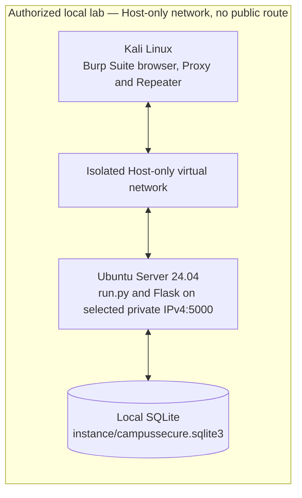

# CampusSecure project architecture

## Purpose and deployment boundary

CampusSecure is one Flask application with a responsive HTML portal and three JSON lab endpoints. The same code, route map, and SQLite schema operate in `secure` and `vulnerable` modes. Its intended deployment is a local Ubuntu Server 24.04 VM accessible only from an authorized Kali Linux VM over an isolated Host-only virtual network. A loopback-only instance is the default. The diagram describes the **planned demonstration topology**, not a network connection verified in this workspace.

The public or campus network has **no connection** to this topology. The operator must verify the hypervisor adapter mode, guest routes, and existing firewall policy. `run.py` never selects `0.0.0.0` and requires explicit Host-only enable, interface name, and assigned private IPv4 for a non-loopback bind. Debug and the reloader are disabled.

## Flask components

| Component | Responsibility |
| --- | --- |
| `app/__init__.py` | `create_app`, configuration, blueprint registration, per-request user loading, POST CSRF validation, HTML/JSON error handlers |
| `app/auth.py` | Login, logout, and HTML `login_required(role)` decorator |
| `app/student.py` | Student dashboard, profile form, request list and owner-scoped detail |
| `app/admin.py` | Administrator dashboard, academic request review, announcement CRUD |
| `app/api.py` | Three JSON lab endpoints, payload validation, status/JSON responses |
| `app/lab_policy.py` | The only mode-dependent authorization decisions |
| `app/db.py` | SQLite connection lifecycle, schema, deterministic seed and reset |
| `run.py` | Local server entry point and explicit bind-address checks |
| `scripts/` | Terminal entry points for seed and reset |

The factory accepts a test configuration so each test can use its own temporary database. Flask stores the SQLite connection in the application/request context and closes it after use. Queries that include user-supplied values use bound parameters.

## SQLite data model

| Table | Key and relationship | Main fields |
| --- | --- | --- |
| `users` | `id` primary key | Unique `username`, Werkzeug `password_hash`, `role` constrained to `student` or `admin` |
| `student_profiles` | `user_id` primary key and foreign key to `users.id` | `full_name`, `email`, `phone`, `department` |
| `academic_requests` | `id` primary key; `student_id` foreign key to `users.id` | `request_type`, `details`, `status`, `submitted_on` |
| `announcements` | `id` primary key; `created_by` foreign key to `users.id` | `title`, `body`, `published_on` |

`app/db.py` enables SQLite foreign keys. `seed_db` creates tables and inserts missing fictional rows without overwriting edits. `reset_db` clears demo tables and restores accounts, password hashes, profiles, requests, statuses, and announcements. Fixed IDs: Alice user 1/request 101 pending; Bob user 2/request 201 approved; admin user 3; announcements 1 and 2. The default file is `instance/campussecure.sqlite3`; `CAMPUSSECURE_DATABASE` may name another file when its parent directory exists.

## Authentication flow

1. `GET /login` creates a session CSRF token and renders the form.
2. `POST /login` validates that token, looks up the submitted username, and checks the password against the stored Werkzeug hash.
3. A successful login clears the prior session, stores only `user_id`, and redirects to the role's dashboard. The next page load creates a fresh CSRF token.
4. On every later request, the factory loads `id`, `username`, and **current role** from SQLite using the signed session's `user_id`. A deleted user clears the session.
5. `POST /logout` requires CSRF and clears the session. Anonymous protected HTML views redirect to login; anonymous API views return JSON `401`.

Flask's signed cookie preserves session integrity; it is not a substitute for TLS or confidential credentials. Cookies are HTTP-only and SameSite=Lax. The local HTTP lab does not set the Secure cookie flag.

## Authorization flow and mode selection

Normal HTML authorization is unchanged by `LAB_MODE`: the `login_required` decorator checks student/admin role; student request SQL includes the signed-in `student_id`; administrator request decisions and announcement management require `admin`. Request decisions use a conditional update on `status='pending'`, preventing another decision from overwriting a completed review.

`create_app` reads `LAB_MODE` at startup, accepts only `secure` or `vulnerable`, and stores the selected value in `app.extensions`. Secure Mode is the default. Invalid values raise `ValueError`; changing the environment or `app.config` after factory creation does not switch an active instance. There is no mode control in the web interface. Both modes use identical endpoints and tables.

| Policy in `app/lab_policy.py` | Secure Mode | Vulnerable Mode |
| --- | --- | --- |
| `may_read_student_request` | Require owner equality | An authenticated student may read another synthetic student's request |
| `may_create_announcement` | Require `admin` role | A signed-in student may call this one API operation |
| `may_assign_own_role` | Reject the `role` field | Allow the signed-in synthetic student's role to be set to `student` or `admin` |

API POST requests require the session CSRF token in `X-CSRF-Token`, a JSON `csrf_token` field, or a form `csrf_token` field. API authorization derives identity and role from the database, never from a client-supplied account ID. The vulnerable role change updates only the signed-in synthetic account; the next request sees the database role and applies ordinary role checks accordingly.

## Endpoint overview

| Method | Endpoint group | Access and result |
| --- | --- | --- |
| `GET, POST` | `/login` | Public login form; valid POST creates a session |
| `POST` | `/logout` | Signed-in user, CSRF required |
| `GET` | `/student/dashboard`, `/student/requests`, `/student/requests/<id>` | Student only; HTML request detail is owner-scoped in both modes |
| `GET, POST` | `/student/profile` | Student only; ordinary contact field updates |
| `GET` | `/admin/dashboard`, `/admin/requests`, `/admin/requests/<id>` | Administrator only |
| `POST` | `/admin/requests/<id>/status` | Administrator only, CSRF; approve/reject pending requests |
| `GET, POST` | `/admin/announcements`, `/admin/announcements/<id>/edit` | Administrator only, CSRF on POST |
| `POST` | `/admin/announcements/<id>/delete` | Administrator only, CSRF |
| `GET` | `/api/requests/<id>` | Signed-in student; Secure foreign object `403`, Vulnerable foreign object `200` |
| `POST` | `/api/admin/announcements` | CSRF; Secure student `403`, Vulnerable student `201`, administrator `201` |
| `POST` | `/api/profile` | Signed-in student and CSRF; Secure `role` field `403`, Vulnerable valid role update `200` |

The API accepts JSON objects or URL-encoded form fields for POSTs. Success and failure responses are JSON, with `401` for anonymous API requests, `403` for forbidden actions, `404` for unknown request IDs, and `400` for malformed fields or invalid CSRF. Detailed contracts are in [PROJECT_SPEC.md](../PROJECT_SPEC.md).

## Templates and static assets

`templates/base.html` provides branding, layout, role-aware navigation, a CSRF-protected logout form, and asset links. `login.html`, `student/`, `admin/`, and `errors/` contain page-specific views. The Jinja templates render server-authorized data; hiding an administrator link is a usability choice and is never the authorization control. `static/css/portal.css`, `static/js/portal.js`, `static/icons.svg`, and locally vendored Bootstrap CSS/JS provide the responsive interface without runtime internet access. JavaScript supports form feedback, confirmation prompts, password visibility, and filtering rows already authorized and rendered by the server.

## Security boundaries and limitations

- Authentication, CSRF, bound SQL parameters, role checks, and ownership checks are server-side. Mode differences are confined to the three named API policies.
- The database and credentials contain only synthetic records. Reset before each scenario, especially after a role update.
- `run.py` checks an assigned private IPv4 and interface name; the human operator verifies Host-only topology, isolation, firewall rules, and absence of public routes.
- The built-in Flask server and published credentials are appropriate only for this educational lab. The project does not claim production readiness or a full security audit.
- Manual Burp and VM evidence remains pending; see [SECURITY_REPORT.md](SECURITY_REPORT.md) and [LAB_GUIDE.md](LAB_GUIDE.md).
